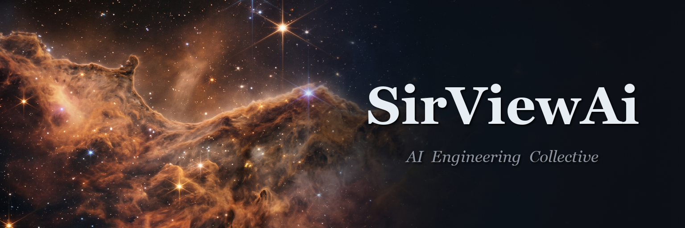
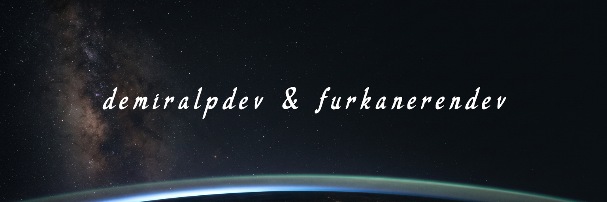

### **Yapay zekâyı küçültüyoruz — zekâyı kaybetmeden.**
*We shrink the model, not the intelligence.*

## 🚀 Ne yapıyoruz?

Büyük dil modellerini damıtma ya da öğrenci model eğitimi **olmadan**, parametre
düzeyinde ameliyatla en hafif hâline indiriyoruz: niceleme (quantization),
vocab budama, katman düşürme — her adım ölçülür, her kazanç kanıtlanır.

| Proje | Açıklama |
|---|---|
| 🍃 **theleaf** | 27B LLM sıkıştırma laboratuvarı — GSQ-RCO IQ2_S taban, vocab pruning, katman ameliyatı: 8.62 GiB → **7.6 GiB** (~%95 zeka koruması) |

## 👥 Ekip

<table>
  <tr>
    <td align="center"><a href="https://github.com/demiralpdev"> <b>demiralpdev</b> Kurucu · AI Engineer</a></td>
    <td align="center"><a href="https://github.com/furkanerendev"> <b>furkanerendev</b> Developer</a></td>
  </tr>
</table>

---

Son ölçüm: PPL 40-chunk protokolü · tüm deneyler tekrarlanabilir kernel'lerde · TR/EN

